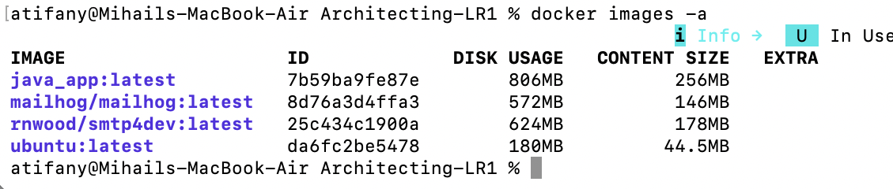
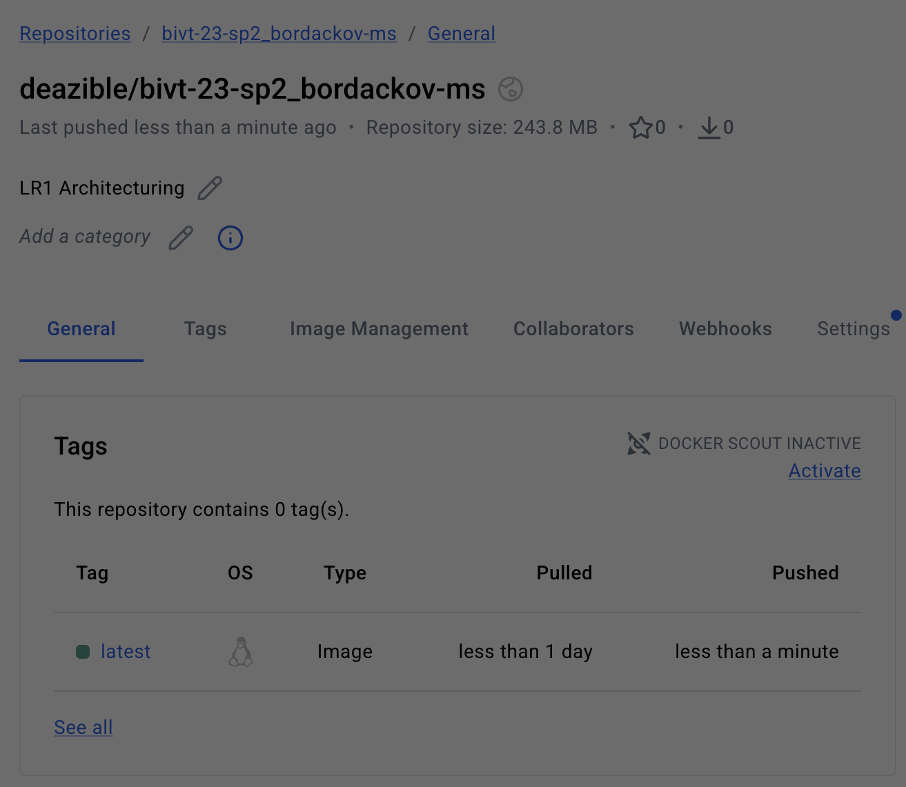
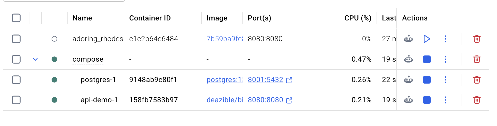
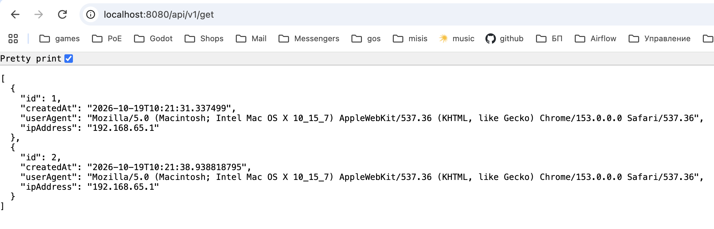

# Architecting-LR1

Упаковал java-приложение из примера в докер через команду
docker build ./ -t "java_app"
И проверил создался ли образ командой docker images -a:

Запушил в реестр образов

Запустил compose:

Проверил, работает ли приложение в compose:
